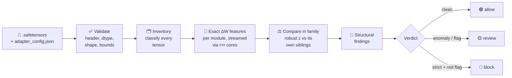

<div align="center">

# 🛡️ AdapterSentry

**Static security scanner for LoRA adapters — catch a backdoor before the first trigger.**

[](https://www.python.org/)
[](LICENSE)
[](CHANGELOG.md)
[](docs/output-schema/scan-result.md)

</div>

A LoRA adapter is a small file that changes how a large language model behaves. Anyone can
publish one, and a poisoned adapter can hide a **backdoor** that stays silent until a trigger
word appears in the input. AdapterSentry inspects the adapter's weights **before** it is
loaded — **without running the model** and **without knowing the trigger**.

- 🚫 **Runs nothing** — reads the `.safetensors` file only; never loads the model or executes code
- 🔍 **Needs no trigger** — works from the geometry of the trained update, not its behaviour
- 📦 **Scales to 70B–405B and MoE** — streamed in ~160 MB of RAM, on CPU
- 🔌 **CI-ready** — JSON and SARIF output, exit codes, a `--fail-on` gate

---

## How it works



| Stage | What happens |
|---|---|
| **① Validate** | The file must be a plain `.safetensors`; header length, dtype, shapes, byte ranges, element counts and LoRA rank are checked **before any tensor is allocated**. |
| **② Inventory** | Every tensor is classified — LoRA A/B pairs (layer, expert, module), full `modules_to_save` weights, DoRA vectors, trainable-token deltas, and anything unanalysable. Nothing is skipped silently. |
| **③ Exact features** | For ΔW = s·B·A (scale `s = α/r` from the config), singular values, norms and row/column norms are computed **exactly** through the tiny r×r matrices AAᵀ and BᵀB. ΔW itself — 235 M values for a 70B MLP layer — is **never built**. Features describe the *shape* of the update (stable rank, participation ratio, spectral entropy, entry kurtosis, row/column concentration), not its size. |
| **④ Compare** | Each module is compared with its family (all `q_proj`, all `down_proj`, …). The verdict looks for one pattern: an update **concentrated on a few outputs**, unlike its siblings (*concentration z*). Needs no reference data; insensitive to adapter strength. |
| **⑤ Structural** | Red flags numbers can't show: full `lm_head`/embedding/router matrices, LoRA on a MoE router, rank ≠ declared `r` (merged adapters), code/pickle/archive files next to the adapter. |
| **⑥ Verdict** | One fail-closed rule set → `allow` / `review` / `block` with reasons, confidence and limits. |

> 💡 **Why shape, not size?** A backdoor that fires on one rare trigger tends to pile the
> update onto a few specific outputs — like one instrument suddenly playing far louder than the
> orchestra. That concentration stays visible in the weights even when the trigger is unknown.

---

## Quick start

```bash
pip install adaptersentry

adaptersentry scan adapter_model.safetensors                      # text summary
adaptersentry scan adapter_model.safetensors --format json        # ScanResult 2.1.0
adaptersentry scan adapter_model.safetensors --format sarif \
    --output adaptersentry.sarif --fail-on review                 # GitHub code scanning + CI gate
adaptersentry batch --input-dir adapters/ --workers 8 --fail-on review
```

```python
from pathlib import Path
from adaptersentry import scan

result = scan(Path("adapter_model.safetensors"))
print(result.verdict.action, result.verdict.level)
```

> Keep `adapter_config.json` next to the `.safetensors` file (as PEFT saves it): the scan
> needs `lora_alpha` to know the real size of the update.

<details>
<summary><b>CLI options</b></summary>

| Option | Meaning |
|---|---|
| `--format text\|json\|full-json\|sarif` | output; `full-json` adds per-module features |
| `--policy default\|strict` | `strict` blocks on structural red flags |
| `--fail-on review\|block` | exit code `2` if the verdict reaches this action |
| `--mode full\|fast` | `fast` uses fewer samples for the kurtosis estimate |
| `--include-modules`, `--include-heads` | per-module / per-head detail in JSON |
| `--full-paths` | report the absolute path instead of the file name |

Exit codes: `0` completed · `1` adapter could not be analysed (verdict still `review`) ·
`2` `--fail-on` threshold reached.
</details>

---

## What you get

```text
$ adaptersentry scan adapter_model.safetensors
AdapterSentry 2.0.2 · adapter_model.safetensors
================================================================
Verdict:  REVIEW (MEDIUM) · confidence medium · behavioural check recommended
Status:   ok · policy default · mode full
Why:
  - [LOW] NO_REFERENCE_PROFILE: No calibrated reference for this model family
  - [MEDIUM] INTRA_OUTLIER: Update concentrated on a few outputs, unlike the rest of its
             family (down_proj layer 47): concentration z = 21.3 ≥ 14.0
Adapter:  peft_lora, family llama (config), 80 layers, r=64, α=128, scaling alpha_over_r
Coverage: 560/560 modules analysed; 0 tensor(s) not analysed
Intra:    concentration z 21.3 · max single-feature z 64.0 · 9 outlier module(s)
```
<sub>Illustrative output.</sub>

| Verdict | Meaning |
|:--:|---|
| 🟢 `allow` | No rule fired. **Not** a proof of safety. |
| 🟡 `review` | An intra-adapter anomaly, a structural flag, or part of the file was not parsed — look closer; behavioural check recommended. |
| 🔴 `block` | Structural red flag under `--policy strict`. The default policy never blocks. |

CI gates read `verdict.action`. Full field reference:
[ScanResult 2.1.0](docs/output-schema/scan-result.md) ·
[JSON Schema](docs/output-schema/scan-result-2.1.0.schema.json).

---

## Limits — read before relying on a verdict

- **A first filter, not a proof.** Weight-space detection is strong in the lab but bounded:
  detectors tuned on known attacks fail on new ones, and on large models the spread between
  honest adapters (different seeds) can exceed a backdoor's signal. A low-risk verdict is
  **not** evidence an adapter is safe — behavioural verification in isolation is still needed
  for untrusted adapters.
- **Calibration is partial.** The threshold (concentration z ≥ 14) was set on **393 popular
  Hub adapters** (Oct 2026, mostly Qwen/Llama ≤ 14B), presumed benign: about **5 %** get
  `review`. Detection was measured only on a **toy payload** inserted into real adapters —
  **71 %** caught when strong, **≤ 3 %** when weak. Real backdoors are not toy payloads;
  labelled measurement and per-family reference profiles are the next steps. Until then
  confidence is at most `medium`.
- **An attacker who knows the detector** can spread a payload across many directions, or pad it
  with inert components. Static analysis alone cannot fully rule this out.
- **Not analysed:** full weight matrices (need the base model), trainable-token deltas; DoRA
  partially. Each is reported and lowers confidence or raises the verdict to `review`.
- **Pickle formats** (`.bin`, `.pt`) are never deserialised — use a serialisation scanner.

---

## Performance

Measured on an 8-CPU server, synthetic Llama-3.3-70B-shaped adapter (80 layers × 7 modules,
r = 64, 1.66 GB bf16): end-to-end in **~18–20 s**, peak memory **~160 MB**. The 1.x engine
needed ~3.3 GB just to load the same file — the exact r×r cores are what let it stay this small.

---

## Testing & feedback

Trying AdapterSentry on your own adapters, or found a **false positive**, a **bug**, or a
**vulnerability**? Test results and reports are very welcome:

- **Telegram:** [@niknkor](https://t.me/niknkor)
- **Email:** [n.korvyakov28@gmail.com](mailto:n.korvyakov28@gmail.com)

A scan report helps a lot — attach the JSON:

```bash
adaptersentry scan ./adapter_model.safetensors --format json --output report.json
```

For a malicious adapter found in the wild, or a security issue, see also [SECURITY.md](SECURITY.md).

---

## Development

```bash
git clone https://github.com/nkorvyakov28-AS/adaptersentry-m1
cd adaptersentry-m1
uv sync --frozen --extra dev        # or: pip install -e ".[dev]"
pytest tests/ -q
```

[Architecture](docs/architecture/m1-architecture.md) ·
[CLI](docs/cli/usage.md) ·
[Batch engine](docs/architecture/scan-engine.md) ·
[CHANGELOG](CHANGELOG.md)

<details>
<summary><b>Migrating from 1.x</b></summary>

| 1.x | 2.x |
|---|---|
| `analyze()` / `scan_to_result()` → `AdapterReport` | `scan()` → `ScanResult` |
| `verdict.recommended_action` | `verdict.action` |
| `overall_score` (0–100) | removed — `verdict.level` + `anomaly` (z-scores) |
| `status`, `parse_status`, `analysis_mode` | `status` + `coverage` |
| `--format summary-json` / `debug-json` | `--format json` / `full-json` |
| `--fail-on LOW…CRITICAL` | `--fail-on review\|block` |
| `--rank` | removed — read from tensors, checked against config |
| `adaptersentry-m1` command | `adaptersentry scan` |

1.x results are not converted — re-scan the adapters.
</details>

AdapterSentry M1 is the open static-analysis layer. Planned: **M2 Behavioral Sandbox** —
advanced behavioral analysis.

## Background

The feature design follows published work on weight-space backdoor detection in LoRA adapters —
*Detecting Backdoored LoRAs from Weights Alone* (arXiv:2602.15195),
*Token-Level Generalization in LoRA Adapter Backdoors* (arXiv:2605.30189) and
Z-PEFT (arXiv:2608.02271): shape over magnitude, per-module and per-head features, MLP
coverage, and one-class calibration instead of a classifier trained on known attacks.

## License

Apache 2.0 — see [LICENSE](LICENSE).
